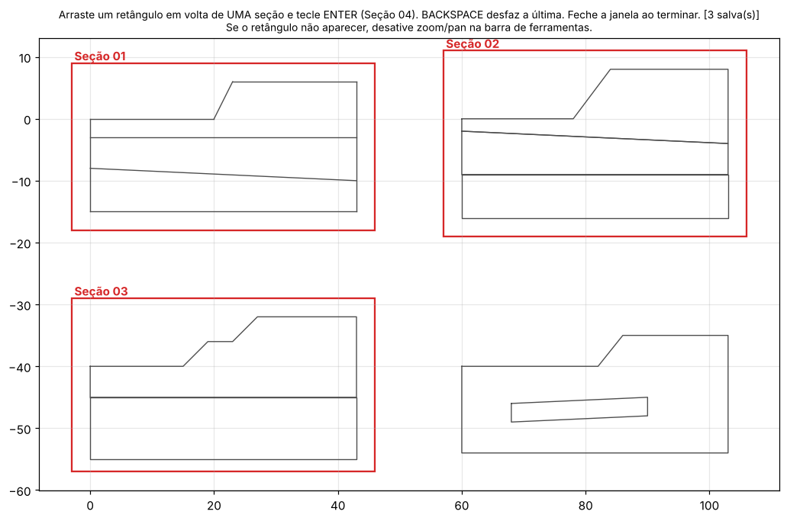
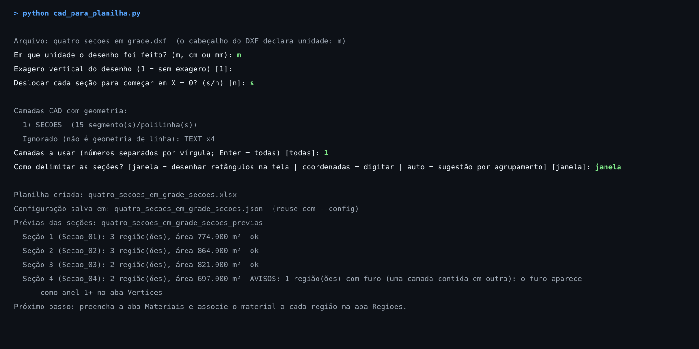
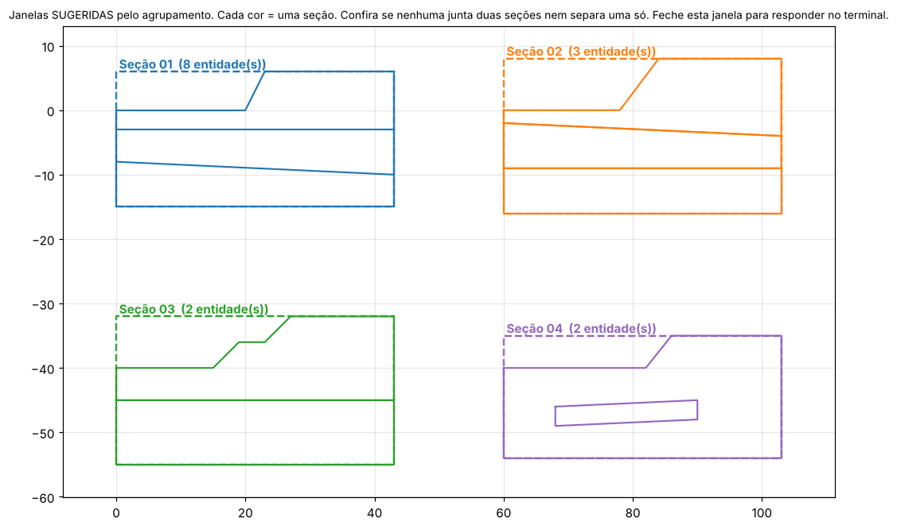
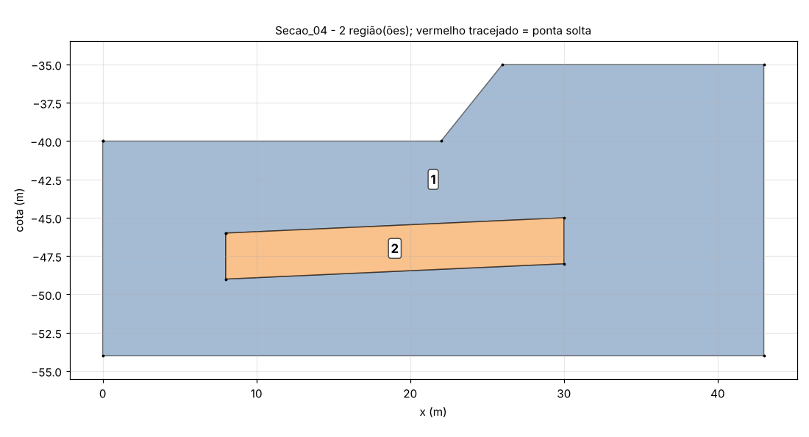
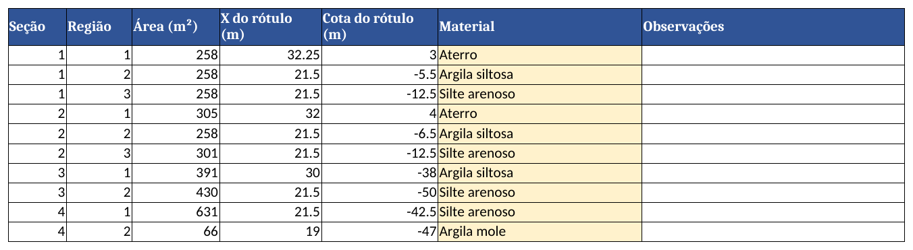

# Slide2 Automação

Automação do **Rocscience Slide2** (estabilidade de taludes por equilíbrio limite) com Python:
das seções desenhadas no **CAD** à **planilha de materiais** e aos **modelos `.slim`** prontos
para calcular.

Os scripts cuidam do trabalho repetitivo de transcrever coordenadas, fechar camadas, validar o
desenho e montar os modelos. As decisões de engenharia continuam com você: quais seções, quais
materiais, métodos, direção de ruptura e tipo de busca.



## Do CAD à planilha em uma rodada

**1. Escolha o DXF e responda poucas perguntas.** A unidade do desenho é sempre perguntada,
nunca adivinhada. Exagero vertical, camadas do CAD e modo de seleção vêm com padrões sensatos.



**2. Delimite cada seção com um retângulo**, numa tela com o desenho inteiro (imagem do topo).
ENTER salva, BACKSPACE desfaz. Só entra na seção o que está inteiro dentro da janela.

Prefere que o script sugira? O modo `auto` agrupa as linhas que se tocam e **mostra a sugestão
no desenho, cada seção numa cor**, antes de você aceitar. Lentes que não tocam nada ficam na
seção que as contém, e a numeração segue a ordem de leitura da prancha.



**3. Confira as regiões.** Cada área fechada vira uma região (camada de solo), numerada de cima
para baixo. Funciona com linhas soltas ou polilinhas, corrige falhas de até 1 mm e aponta, com
coordenadas, o que não fecha.



**4. Associe os materiais na planilha.** A aba `Materiais` recebe γ, c' e φ'. Na aba `Regioes`,
cada região ganha seu material por lista suspensa. As prévias numeradas também vão na planilha.



## Validações do desenho

- **Pontas soltas e falhas de fechamento:** com coordenadas, em vermelho na prévia.
- **Falhas de até 1 mm e vértices em T sobre linhas inclinadas:** encaixados automaticamente.
- **Lentes e bolsões:** viram furo na camada envolvente.
- **Partes desconectadas, vazios sem material, janelas sobrepostas e entidades cortadas.**
- **Limite de 20 materiais por modelo** (Slide2).
- **DWG e DXF vazio:** recusados com instrução.

## Módulos

| Pasta | O que faz | Situação |
|---|---|---|
| [`01_modelo_basico`](modulos/01_modelo_basico) | Cria um `.slim` com contorno externo e um material a partir de um modelo-base | Funciona; primeiro teste |
| [`02_cad_para_planilha`](modulos/02_cad_para_planilha) | DXF → seções → regiões → planilha-padrão com prévias | **v0.3**, testado |
| [`03_planilha_para_slim`](modulos/03_planilha_para_slim) | Planilha → um `.slim` por seção, várias camadas, opções de análise no terminal | Em especificação |
| Cálculo em lote | Rodar o Slide2 e tabelar o FS de cada seção | Planejado |

Próximos passos em [`docs/roadmap.md`](docs/roadmap.md); formato do arquivo do Slide2 em
[`docs/formato_sli.md`](docs/formato_sli.md).

## Instalação

Python 3.9 ou mais novo. Para as etapas de cálculo, Windows com o Slide2 instalado.

```bash
git clone https://github.com/victortlacerda/slide2-automacao.git
cd slide2-automacao
pip install -r requirements.txt
```

## Uso

```bash
# DXF -> planilha: abre a janela para escolher o arquivo e pergunta o resto no terminal
python modulos/02_cad_para_planilha/cad_para_planilha.py

# Repetir uma rodada sem perguntas
python modulos/02_cad_para_planilha/cad_para_planilha.py --config desenho_secoes.json

# Modelo básico com boundary e um material
python modulos/01_modelo_basico/slide2_editar_modelo.py
```

Para experimentar, use os DXFs em [`exemplos/`](exemplos). Cada módulo tem um README com todas
as perguntas, opções e limitações.

## Qualidade

- **Testes automáticos** (`pytest testes`) com DXFs sintéticos: linhas × polilinhas, vértice em T,
  falhas de 0,4 mm e 10 cm, furo, arco, unidades, exagero vertical, planilha, modo auto e seletor.
- **GitHub Actions** roda os testes a cada envio.
- **As imagens deste README** saem do script rodando de verdade: `python docs/gerar_imagens.py`.

> **Responsabilidade técnica.** O formato `.sli`/`.slim` não é uma API documentada da Rocscience;
> foi lido a partir de arquivos salvos pelo programa. Abra sempre os modelos gerados no Slide2 e
> confira a geometria. A ferramenta acelera o trabalho, mas não substitui a verificação do projetista.

## Referência

A abordagem de editar o modelo texto e rodar o motor de cálculo segue Crisp & Davies (2022),
*A tool for soil nail wall design optimisation using Slide2 and Python*
(ver [`docs/referencias.md`](docs/referencias.md)).
